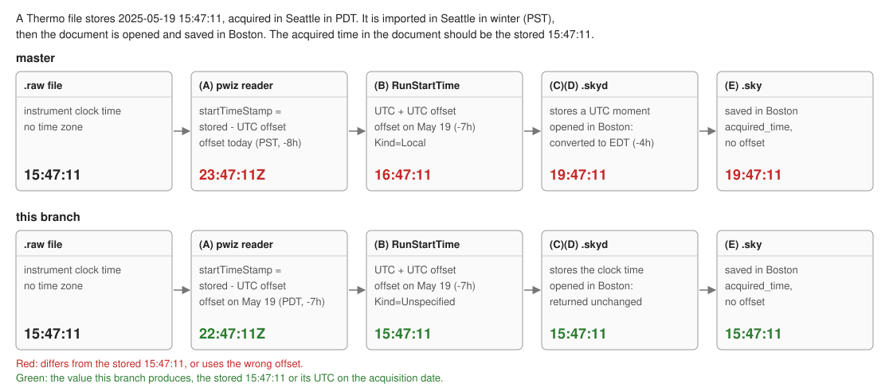

# Thermo acquired time shifts by an hour depending on the date of import

## Branch Information
- **Branch**: `Skyline/work/20261108_thermo_acquired_time_host_offset`
- **Base**: `master`
- **Module**: `pwiz`
- **Status**: In Progress
- **PR**: (pending)

## Objective

The same Thermo .raw file imported into Skyline in summer and in winter gets acquired times one hour apart.
Panorama Public compares acquired times across documents to decide whether two sample files with the same name are
the same file, so a difference can make it treat one file as two.

Two separate defects

- The pwiz reader (`ReaderConfig.FormatStartTimeStamp`) converts the stored time to UTC with the offset on the date
  the file is read, not the date of acquisition
- Skyline stores the acquired time in the .skyd as a `Kind=Local` value, so opening a document in another time
  zone changes it

Thermo stores the instrument's local clock time with no time zone, and the SDK labels it UTC. SCIEX `.wiff` files
store the same kind of value and go through the same code.

## How the time reaches the document

```
  .raw file             pwiz reader                 Skyline (MsDataFileImpl)
 +-----------+   (A)   +-----------------------+   (B)   +------------------------+
 | clock     | ------> | startTimeStamp        | ------> | RunStartTime           |
 | time,     |         | = stored - UTC offset |         | = UTC + UTC offset     |
 | no zone   |         | "...Z"                |         |                        |
 +-----------+         +-----------------------+         +------------------------+
                                                                             |
                                                                             | (C) ToBinary
                                                                             v
 +------------------------+   (E)   +---------------------------+   (D)   +-------------+
 | .sky                   | <------ | ChromFileInfo.RunStartTime| <------ | .skyd       |
 | acquired_time,         |         | read with FromBinary      |         | 64-bit value|
 | no offset written      |         +---------------------------+         +-------------+
 +------------------------+
```

- **(A)** `ReaderConfig.FormatStartTimeStamp` subtracts the reading computer's UTC offset and appends `Z`
- **(B)** `DateTime.TryParse` converts the `Z` value back to local time by adding the UTC offset on the acquisition
  date
- **(C) and (D)** `ChromatogramCache` stores the `DateTime` in the .skyd with `ToBinary()` and returns it with
  `FromBinary()`. What comes back depends on its `Kind`
- **(E)** Skyline writes `acquired_time` to the .sky as the clock time with no offset. Skyline reads the acquired
  time only from the .skyd, never from the .sky. Panorama reads `acquired_time` from the .sky

## Defect 1 - UTC offset from the date the file is read

- Step A runs in `ReaderConfig.FormatStartTimeStamp` (`pwiz/data/msdata/IReader.cs`) when
  `AdjustUnknownTimeZonesToHostTimeZone` is on. It is on by default, and Skyline does not change it
- On master, step A took the offset from `TimeZoneInfo.Local.GetUtcOffset(DateTime.Now)`, the offset on the date
  the file is read
- Steps A and B cancel only when the file is read in the same DST period it was acquired in. Otherwise Skyline
  shows the time one hour off

### Fix

- `FormatStartTimeStamp` takes the offset on the acquisition date, `hostZone.GetUtcOffset(stamp)`. `stamp` has
  `Kind=Unspecified`, so `GetUtcOffset` reads it as a clock time in the host's zone. The SDK value has `Kind=Utc`
  and would give the wrong offset in the hours after a DST change
- An `internal` overload takes the `TimeZoneInfo`, so the test can supply its own zone. The public overload passes
  `TimeZoneInfo.Local`
- Skyline now records the stored clock time when the file is imported on any computer, on any date
- A clock time in the hour that repeats when DST ends, such as 1:30 AM on the first Sunday of November in Pacific,
  occurs once in PDT and once in PST, and the stored value does not say which. `GetUtcOffset` treats it as standard
  time and returns the PST offset (-8h), so for a file acquired in the first pass the UTC value from step A is an
  hour late. Step B converts it back to the same clock time, so Skyline still shows the stored time. Not tested

## Defect 2 - acquired time changes when the .skyd is opened in another time zone

- `MsDataFileImpl.RunStartTime` returned a `Kind=Local` value
- `ToBinary()` stores a `Local` value as a UTC moment, and `FromBinary()` converts it to the zone of the computer
  that opens the .skyd
- A file that stores 15:47:11, imported in Seattle in summer, is shown as 18:47:11 when the document is opened in
  Boston, and a save there writes 18:47:11 to `acquired_time` in the .sky. Not yet tried in Skyline

### Fix

- `MsDataFileImpl.RunStartTime` returns the value with `DateTimeKind.Unspecified`, so the .skyd stores the clock time
  as is and returns it unchanged on any computer. `Unspecified` and not `Utc`, since the value is a clock time with
  no zone
- Made in `ProteowizardWrapper.PwizSharp/MsDataFileImpl.cs`, the one the Skyline build compiles, and in the older
  `ProteowizardWrapper/MsDataFileImpl.cs` for parity, which is not compiled or tested
- .skyd files written before the fix keep their `Local` values and still shift in another zone. The .skyd does not
  record the original zone, so they cannot be corrected on read. Re-importing fixes them

## Both defects together

The example uses a Thermo file acquired in Seattle that stores `2025-05-19 15:47:11`. It is imported in Seattle in
winter, then the document is opened and saved in Boston. Master gets defect 1 in step A and defect 2 in steps C
and D. With this branch, the acquired time in the Skyline document is `15:47:11`, the stored value, on any
computer. The conversion to UTC assumes the file is read on a computer in the time zone where it was acquired,
but not in the same DST period.

The master values in steps C to E follow from how `ToBinary` and `FromBinary` handle a `Local` value and have
not yet been tried in Skyline.



## Tests

- `FormatStartTimeStampTests.FormatStartTimeStamp_UsesOffsetOnAcquisitionDate` (MsData.Tests) uses a custom
  Pacific zone, so the result is the same on every computer. It checks a summer, a winter and a just-after-DST
  acquisition, and the stored value with the adjustment off
- `PwizFileInfoTest.TestRunStartTime` (Skyline, needs vendor readers) reads a real Thermo raw file through
  `MsDataFileImpl.RunStartTime`. It expects the stored clock time and `Kind=Unspecified`
- Both were run failing on the unfixed code and passing with the fix

## Open question - Shimadzu shifted twice

Not fixed on this branch, pending a check with Matt Chambers.

- The Shimadzu SDK returns `AnalysisDateRaw` with `Kind=Local`, which looks like a point in time converted to the
  reading computer's zone
- `Reader_Shimadzu` calls `ToUniversalTime()` and then passes the result to `FormatStartTimeStamp` with the
  adjustment on, which subtracts the host offset a second time
- The mzML `startTimeStamp` is off by the reading computer's UTC offset. Skyline takes one offset off again on
  parse, so the document shows the UTC clock time on every computer
- Passing `false` to `FormatStartTimeStamp` for Shimadzu would make the mzML the true UTC, but the document would
  then show the time in the importing computer's zone, and the same file imported in two zones would get two values
- The vendor test harness runs with the adjustment off, so its reference mzMLs do not show this

`startTimeStamp` measured on a Pacific computer in PST, with this branch's fix

| File | SDK value (Kind) | Adjustment off | Adjustment on |
|---|---|---|---|
| `10nmol_Negative_MS_ID_ON_055.lcd` | 2017-11-20 02:20:59 (Local) | 10:20:59Z | 18:20:59Z |
| `20140312_六mix_column_1 (scheduled) 一个试.lcd` | 2014-03-11 23:02:53 (Local) | 06:02:53Z | 13:02:53Z |

The second file's name gives 2014-03-12, which matches the UTC date and not the Pacific one. That supports the
adjustment-off value as the true UTC.

## Tasks

- [x] Fix defect 1 in `FormatStartTimeStamp`, with `FormatStartTimeStampTests`
- [x] Fix defect 2 in both `MsDataFileImpl.RunStartTime` implementations, with `TestRunStartTime`
- [ ] Open the PR
- [ ] Decide the Shimadzu change
